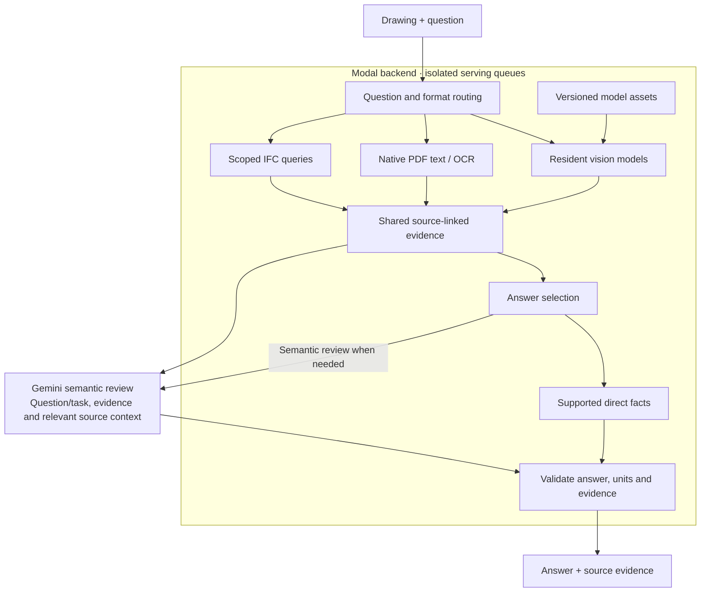

# FloorHAWK

### Make Blueprints Talk

**Team Academic Menaces · STOA Challenge · Junction 2026**

**Demo video: pending.** A FloorHAWK YouTube URL has not yet been supplied. When available, this section will use a clickable thumbnail linking to the video.

**[Open the protected live demo](https://sm-hariprasanth--web.us-east.modal.run)** · Judges receive access privately from the team. No access code or API key is included in this repository. Presenter links and controls are in the [operator guide](docs/EVENT_OPERATIONS.md).

Construction drawings scatter useful information across small symbols, room labels, schedules and building-model properties. FloorHAWK lets reviewers ask questions about PNG/JPEG drawings, PDFs and IFC models, then inspect the source evidence behind the answer. It combines existing specialist models and structured extraction with selective Gemini review, presenting one result while retaining separate local and review records for analysis.

## Architecture



Gemini does not invoke every tool or decide every answer. Supported deterministic facts can bypass provider review. Evaluation references are kept outside inference inputs.

## Capabilities and measured scope

- Count supported doors, windows and fixtures using specialist observations and instance deduplication.
- Read printed PDF labels and room areas; use OCR for supported raster text.
- Query IFC entities, properties and available quantities without waiting for geometry.
- Inspect numbered regions, readable crops and source-matched IFC GUID highlights; export an annotated image/page.
- Compute curated examples live. Source previews may be cached; saved answers are not replayed as fresh inference.

|Measurement|Observed result|Qualification|
|---|---|---|
|Frozen numeric development baseline|6,641/9,471 — 70.12%|Saved v3 run; development data|
|Cached development candidates|Best 7,925/9,471 — 83.68%; serving-policy estimate 83.66%|Grouped calibration; not verified full deployed Hybrid accuracy|
|Partial final LocalCPU evaluation|4,214/5,602 recorded — 75.22%; 5,602/6,876 coverage|Deterministic partial subset; unknown custom-training overlap for PNGs|
|Fresh curated live checks|18/18 selected suggestions matched recorded references|Browser checks, not held-out benchmark accuracy|

The development set contains 9,544 questions; 73 narrative references remain ungraded. The overall 85% development target was not reached. Missing final results remain visible: correct/all eligible is 4,214/6,876 (61.29%). The complete PDF stratum scored 1,106/1,298 (85.21%), with no known local training/development overlap; external pretrained overlap remains possible. These measurements must not be combined into a single accuracy claim. See [current analytics](SOLUTION_ANALYTICS.md) and [final evaluation](docs/FINAL_EVALUATION.md).

Selected staging warm browser requests had a 5.26-second median across 17 requests, with a 4.64–7.55-second range. This is not a latency guarantee; cold starts, queueing and semantic review add time. Cached retrieval timings are not cold inference measurements.

## Gemini

Gemini complements domain-specific models by reviewing ambiguous questions and cumulative local observations alongside relevant drawing context. Depending on the route, its context includes the question or registered task, local hypotheses and source imagery. Structured proposals retain source-linked regions and are checked for supported values, units and evidence references before presentation. The final policy may retain specialist evidence or select a grounded proposal; it does not average conflicting counts. Provider failure preserves an explicitly labelled local fallback. A valid response schema alone does not establish correctness.

## Modal

Modal serves the pipeline independently of the laptop, using versioned model storage and resident GPU models that avoid repeated loading between nearby requests. Presenter, judges and public traffic use separate workers and admission state. Each role is bounded to one T4 worker; presenter and judges can remain warm, while public capacity scales from zero. Browser concurrency is not equivalent to simultaneous GPU inference capacity. Access control, durable quotas and spending reservations remain server-side.

## Codex

The team used Codex to implement model adapters, source-coordinate evidence, evaluation and diagnostics, focused tests, browser verification, deployment automation and reproducible release packaging. The team supplied technical direction and reviewed the prototype. Automated checks support development; they do not prove model correctness or replace engineering review.

## Quick start

For the event, open the protected demo above using the access provided privately by the team. For local development, restore the external assets and authorized datasets described in [ARTIFACTS.md](ARTIFACTS.md), then run from the repository directory:

```bash
bash scripts/restore_environment.sh
# In a normal Ubuntu terminal, start one host GPU worker:
bash start_host_worker_v2.sh
# In a second terminal:
bash start_live.sh --port 8777
```

Open http://127.0.0.1:8777. The environment script installs project-local dependencies; no system Python or NVIDIA-driver changes are required. Existing assets, configuration and accounting must be restored rather than replaced with an empty allowance. See [.env.example](.env.example) for path placeholders. Provider credentials remain server-side and external to Git.

- [Architecture, routing and caching](docs/architecture.md)
- [Demo and recording guide](docs/RECORDING_GUIDE.md)
- [Deployment, access, limits and shutdown](docs/EVENT_OPERATIONS.md)
- [Release updates and rollback](docs/RELEASE_WORKFLOW.md)
- [Model inventory and restoration](ARTIFACTS.md)
- [Current status](STATUS.md) and [event verification](docs/EVENT_READINESS.md)

## Limitations, acknowledgments and licensing

This is an event/research prototype, not a certified quantity-surveying or design system. Small symbols, unusual drawing conventions, OCR errors and ambiguous scope can produce wrong or unsupported answers. Count agreement is not localization proof. Large-sheet processing is bounded and incomplete coverage must not be presented as a total. Custom detector training identities are unavailable, so CubiCasa results are not certified unseen. Model-proposed regions are distinguished from verified local observations.

We acknowledge STOA and Junction for the challenge and supplied development sources, and the following components actually used:

- [CubiCasa5K](https://github.com/CubiCasa/CubiCasa5k): floor-plan dataset, room/icon model and reference processing. Applicable code/model and supplied-data noncommercial licenses remain in force.
- [RT-DETR floor-plan detector](https://github.com/OldDeLorean/rtdetr-floorplan-detector) and [Ultralytics](https://github.com/ultralytics/ultralytics): structural detections and runtime. The separately supplied YOLO11m fixture detector is credited to its author **pending identification**; no author name or redistribution grant is inferred.
- [RapidOCR](https://github.com/RapidAI/RapidOCR), [PaddleOCR](https://github.com/PaddlePaddle/PaddleOCR) and [ONNX Runtime](https://github.com/microsoft/onnxruntime): CPU OCR with the recorded PP-OCRv5 Latin assets; Tesseract is available for existing bounded OCR tooling.
- [PyMuPDF](https://github.com/pymupdf/PyMuPDF): native PDF text, coordinates and rendering. [IfcOpenShell](https://github.com/IfcOpenShell/IfcOpenShell): structured IFC extraction and geometry. [Three.js](https://github.com/mrdoob/three.js): browser model visualization.
- [PyTorch](https://github.com/pytorch/pytorch), [OpenCV](https://github.com/opencv/opencv), [Shapely](https://github.com/shapely/shapely) and [scikit-image](https://github.com/scikit-image/scikit-image): model execution, image processing and geometry.

Exact revisions, hashes and license notes are in [MODEL_REGISTRY.json](MODEL_REGISTRY.json), [v2/registry.json](v2/registry.json) and the artifact manifest. Restricted drawings, weights and credentials are excluded from Git. No blanket project license overrides third-party terms, including CubiCasa noncommercial conditions, Ultralytics AGPL requirements and PyMuPDF/IfcOpenShell licensing. Review upstream terms before redistribution or commercial use.
