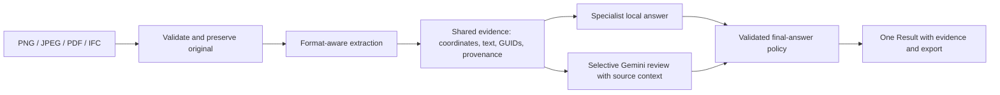
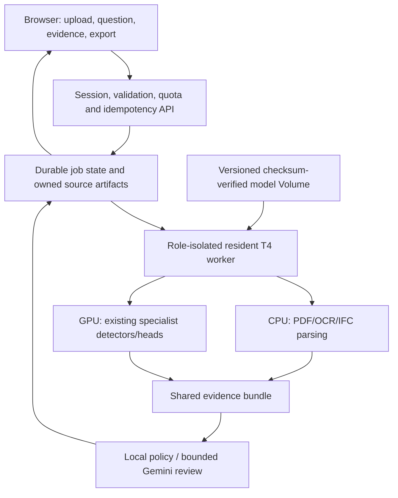

# FloorHAWK

**Team Academic Menaces · STOA — Make Blueprints Talk · Junction 2026**

FloorHAWK helps engineers, estimators and drawing reviewers ask questions about construction drawings and inspect the source evidence behind the answer. Tiny symbols, rotated labels and model properties are difficult to search manually. The prototype combines specialist vision, text extraction and IFC queries with selective Gemini review, then shows one Result with source-linked evidence. It is a review aid, not a certified measurement or design tool.

## Try the protected event demo

|Role|URL|Serving capacity|
|---|---|---|
|Presenter|https://sm-hariprasanth--presenter.us-east.modal.run|Dedicated warm T4, max1|
|Judges/company|https://sm-hariprasanth--judges.us-east.modal.run|Separate warm T4, max1|
|Public audience|https://sm-hariprasanth--web.us-east.modal.run|Min0/max1 T4, bounded visitor queue|

Access codes remain in private operator files; no credentials are distributed in this repository. Public inference is protected, not unlimited. Its retained cumulative7USD conservative compute guard currently has5.75USD reserved, leaving five0.25USD admissions; this is separate from rolling visitor limits and is not actual billing. Presenter/judges are independent. Warm resources remain billable until turned off.

Private submission repository: https://github.com/HariPrasanth-SM/floorhawk . Presentation video: **pending** (no supplied video URL).

Current deployment source: `8fce90834c82935f6180baac8a7071763269b183`; frozen inference base: `5827eab5e423bae3eb7413a2c773183afa2f60f0`. The later correction adds explicit platform CPU/RAM limits only; frontend, inference and model hashes remain frozen. [Release manifest](docs/release-manifest.json) · [Operator commands and rollback](docs/EVENT_OPERATIONS.md) · [Browser verification](docs/OVERNIGHT_DEPLOYMENT_VERIFICATION.md).

## Working pipeline



1. Validate bounded file bytes, decoded dimensions and format. Preserve the original; show a lightweight preview immediately. IFC metadata can be answered without waiting for geometry.
2. Route by format, question and available evidence. Native PDF text/coordinates precede OCR. IFC entity/property queries preserve units and scope. Existing RT-DETR, CubiCasa and the supplied YOLO detector provide supported visual observations.
3. Build cumulative local evidence once within a request. Numbered regions retain source coordinates and model provenance. A score is a detector score, not calibrated completeness probability.
4. Use deterministic supported facts directly. For ambiguous supported semantic targets, Gemini may inspect the question, local observations and bounded readable source context. References never enter extraction, routing or provider payloads. Numerical proposals need supporting evidence; counts are not averaged.
5. Validate status, values, units and evidence IDs, then present one Result. Local and review outputs remain separate internally. Provider failure preserves a supported **Local fallback — Gemini unavailable**; insufficient evidence can abstain.
6. Display source crops, selected regions and optional GUID-linked IFC geometry. Export an annotated source page/image. Curated reference cards are UI/evaluation data only and disappear when source/question/scope changes.

## Architecture and component roles



|Component|Role|Important limitation|
|---|---|---|
|RT-DETR|Structural door/window candidates|Domain, scale and instance grouping affect recall|
|CubiCasa and existing heads|Room/icon/layout evidence and supported counts|Scalar count agreement does not prove localization|
|Supplied custom YOLO11m|Supported fixtures and corroborating openings|Training identities unavailable; potential CubiCasa overlap|
|Native PDF / CPU OCR|Printed room labels, values and source-coordinate text|Legends/schedules are not physical room instances|
|IfcOpenShell|Scoped entities, GUIDs, properties and available quantities|A PDF does not imply access to an associated IFC|
|Gemini|Selective semantic evidence review|Can fail or be wrong; structured output alone is not truth|
|Viewer|Pan/zoom, crops, overlays and asynchronous IFC geometry|Never invents missing reference geometry or boxes|

**Codex** implemented adapters, diagnostics, tests, cache provenance, source packaging and deployment operations. Generated code still requires review. No side-challenge eligibility is guaranteed.

**Gemini** uses server-side credentials and durable concurrency-safe reservations against the existing100USD authorization. The existing80USD serving envelope is already part of that allowance, not extra money. Old tiny permit/request limits are not the event policy. Retries, timeouts, accounting and kill switches remain; reservations and partial token estimates are not actual billing.

**Modal** runs explicit Python3.11 cloud images with models loaded directly into resident T4 workers. No cloud worker depends on the laptop bridge. Presenter, judges and public share one versioned backend/frontend but separate admission, jobs, session credentials and GPU queues. GPU workers are bounded at2CPU cores/8GiB and max1per role; API workers at1core/4GiB. Warm presenter/judges workers are intentionally billable.

Detailed [architecture, routing, preprocessing, cache and security](docs/architecture.md). [Model registry](MODEL_REGISTRY.json) and [asset restoration/licensing](ARTIFACTS.md) describe external weights and provenance.

## Measured results and limits

The9,544-question quick set is **DEVELOPMENT**, with448drawing/project groups and9,471valid numeric references.73narrative text references remain ungraded under the frozen rubric. Counts require exact numerical agreement; quantities keep the fixed unit normalization/2% tolerance. Abstentions, unsupported outputs and execution failures stay in the primary denominator.

|Saved development result|Correct / valid numeric references|
|---|---:|
|Frozen v3 baseline|6641/9471 (70.12%)|
|Local specialist candidate|7205/9471 (76.07%)|
|Best cached, drawing-group out-of-fold estimate|7925/9471 (83.68%)|
|Practical serving-policy estimate|7923/9471 (83.66%)|

**The85% target was not reached.** Cached development comparisons are not fresh full live measurements or held-out generalization. Practical policy answer coverage9179/9544(96.18%), countMAE0.484050/signedbias-0.250121 on8276valid answered counts. [Current analytics](SOLUTION_ANALYTICS.md) reports denominators, categories, regressions and final-evaluation status separately.

Fresh normal-login verification: all18curated suggestions plus manual PNG/PDF/IFC uploads passed on the frozen inference release. IFC fzk source produced107actual meshes with11recorded window GUID highlights, including manual upload. Resource-bound canary repeated18/18. Each final role then passed a fresh GPU-backed door question; models loaded once. These curated checks are not benchmark accuracy. New browser checks used0provider calls; a new successful semantic review on each serving role is not claimed.

Selected staging timing: first cold browser query27.67s included an injected polling failure;17warm requests median5.26s/range4.64–7.55s. Final resource-bound spot checks: presenter9.40s,judges14.19s,public32.99s(cold+polling fault). No fixed latency/p95 promise or speed claim from cached retrieval. Raw timing and device evidence: [deployment verification](docs/OVERNIGHT_DEPLOYMENT_VERIFICATION.md).

Remaining final candidates:6,876questions,354sources.1,298PDFquestions have no known local training/development overlap;5,578CubiCasa questions have unknown custom-training membership. External pretrained overlap remains possible. Frozen LocalCPU evaluation is separate from serving Hybrid and may have partial coverage. No final-reference feedback is used for tuning.

## Operator quick start

Run from the canonical `proofplan/` directory after restoring external assets and dependencies:

```bash
.venv/bin/python deploy/modal/presenter_ops.py warm
.venv/bin/python deploy/modal/presenter_ops.py ready
.venv/bin/python deploy/modal/presenter_ops.py status --admission --budget
.venv/bin/python deploy/modal/presenter_ops.py warm --app floorhawk-judges
# Stop permanent warming (queries may still cold-start):
.venv/bin/python deploy/modal/presenter_ops.py off
.venv/bin/python deploy/modal/presenter_ops.py off --app floorhawk-judges
```

Full shutdown, protected access file paths, deployment, backend-only updates and pinned rollback: [EVENT_OPERATIONS.md](docs/EVENT_OPERATIONS.md). Do not expose the laptop worker publicly.

Preserved laptop launchers, from the parent directory:

```bash
bash proofplan/start_host_worker_v2.sh
bash proofplan/start_live.sh --port 8777
# Separate recorded inspection, no inference/API calls:
bash proofplan/start_demo_v3.sh --replay --include-failures --port 8774
```

Use one host worker; an already-running user worker should be preserved. Laptop Local/replay require no provider credentials. Existing laptop routing/default benchmark behavior remains separately preserved; event cloud policy is configured in its immutable release. Environment path placeholders: [.env.example](.env.example). Keys, access codes and the existing lifetime ledger remain external; never create an empty ledger to evade limits.

## Large drawings and evidence

Retain original pixels and use a reduced preview only for display/context. The optional isolated large-sheet path uses overlapping source tiles, original-coordinate mapping and class/location deduplication; it never sums global room/storey heads. Partial coverage is not a total count. File/decode/tile/time limits and decompression-bomb protection remain. The frozen CPU final-evaluation path has its own explicit8MP bound. Full-sheet large-PDF performance is not established. Tiny symbols, faint linework, rotated text and scope ambiguity remain limitations. Printed raster scale alone does not establish pixel calibration; floor area is not baseboard length.

## Reproduce and share responsibly

- [Morning handoff](MORNING_HANDOFF.md), [status](STATUS.md), [development analysis](docs/OVERNIGHT_DEVELOPMENT.md), [recording questions/files](docs/RECORDING_GUIDE.md).
- Regenerate saved development analytics: `.venv/bin/python -m campaign.report_development`.
- [Release/deployment workflow](docs/RELEASE_WORKFLOW.md), [artifact manifest/restoration](ARTIFACTS.md), [verification](docs/OVERNIGHT_DEPLOYMENT_VERIFICATION.md).
- Original datasets, weights, predictions, corrected splits and budget history remain external and unchanged. Source exports exclude secrets, agent transcripts, private drawings and bulk artifacts. Submission Git stays private.
- Acknowledgments: STOA/Junction challenge data, CubiCasa5K, supplied custom detector authors, RT-DETR/Ultralytics, OCR/PDF/IfcOpenShell ecosystem, Google Gemini and Modal. Model/code licenses retain their original terms, including CubiCasa noncommercial restrictions and applicable UltralyticsAGPL requirements. No blanket license grants redistribution/commercial rights to supplied drawings/weights. Review upstream provenance before reuse.

Earlier release notes are preserved in [history](reports/history/2026-11-15-pre-final-readme.md). This event prototype is not commercially validated or a substitute for engineering judgment.
