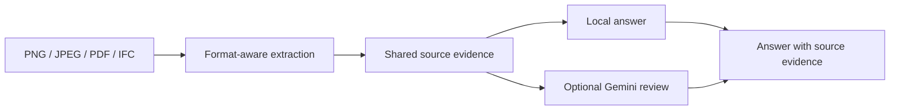
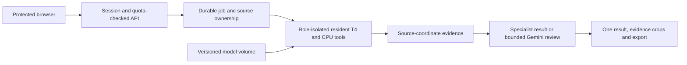

> Current protected presenter and operator commands: [Presenter deployment](docs/PRESENTER_DEPLOYMENT.md). Recording questions/source paths: [Recording guide](docs/RECORDING_GUIDE.md). Public deployment remains unchanged.

# FloorHAWK — drawing questions with inspectable source evidence

**Academic Menaces · STOA — Make Blueprints Talk · Junction 2026**

Verified event release: `5827eab5e423bae3eb7413a2c773183afa2f60f0`.

|Role|Protected URL|GPU warming|
|---|---|---|
|Presenter|https://sm-hariprasanth--presenter.us-east.modal.run|One resident T4|
|Judges/company|https://sm-hariprasanth--judges.us-east.modal.run|One separate resident T4|
|Public|https://sm-hariprasanth--web.us-east.modal.run|Min0/max1 T4|

Access codes stay in the operator’s private files. [Event operations and shutdown](docs/EVENT_OPERATIONS.md), [actual browser verification](docs/OVERNIGHT_DEPLOYMENT_VERIFICATION.md), [model/config release manifest](docs/release-manifest.json). Presenter and public URLs were preserved. The public conservative7USD reservation guard currently leaves six additional admissions; use presenter/judges for recording. Warming is billable until disabled.

Protected public demo: https://sm-hariprasanth--web.us-east.modal.run . Access is required for paid inference. Presentation video: **pending** (no video URL supplied).

The frozen overnight candidate is described in [the campaign checkpoint](docs/OVERNIGHT_PROGRESS.md). Frozen v3 development: **6,641/9,471 numeric references (70.12%)**. The best overnight cached-observation, drawing-group out-of-fold estimate is **7,925/9,471 (83.68%)**, across 9,544 development questions; 73 narrative references remain ungraded. This is development calibration, not untouched accuracy or a fresh end-to-end production measurement. The 85% target has not been achieved.

Stoa’s drawing-review problem is turning large construction sheets and models into useful, checkable answers without repeatedly searching tiny labels or trusting unsupported quantities. Intended users are engineers, estimators and drawing reviewers who need to inspect the source before accepting an answer.

FloorHAWK is a Python/browser prototype that extracts format-appropriate evidence once per accepted request, answers supported questions with local tools, and selectively asks Gemini to review cumulative evidence and bounded source crops. Cloud event deployments present one Result; independent Local/review outputs remain in diagnostic records. The viewer keeps model output, human corrections and prerecorded ground-truth references separate. It supports exploration and review; an answer is not a verified design or a complete inventory.



Components:

- **Detectors:** existing RT-DETR windows/doors and CubiCasa room/fixture routes. Class scores are not calibrated probabilities. Large drawing tiles never sum global room/storey heads.
- **OCR / PDF:** existing CPU OCR reads raster source tiles; native PDF extraction retains page/rotation coordinates. Printed scale ratios alone do not calibrate raster measurements.
- **IFC:** parsed entities, GUIDs and properties answer supported queries without requiring geometry rendering. Cached geometry is optional viewer context.
- **Gemini:** optional structured review of shared local evidence, an overview and a bounded selection of source crops. It can disagree or abstain; proposals remain labelled and references are never provided to inference.
- **Viewer:** preview, pan/zoom, numbered evidence, original-resolution crops, separate answers/review and exports. Replay performs no inference.

## Contributions and deployment

**Codex** implemented and tested adapters, source-coordinate evidence, browser workflows, release packaging and operational checks. Generated code still requires review; a model answer is never a construction certification.

**Gemini** reviews cumulative local observations plus bounded source imagery when semantic interpretation is needed. Deterministic IFC/native-PDF facts and supported specialist detections can be selected without a provider call. Local results remain separate internally; provider failure retains an explicitly labelled local fallback. Evaluation references are kept outside inference.

**Modal** runs Python 3.11 CPU/API containers and isolated resident T4 workers using versioned, checksum-verified external assets. Presenter, judges and public roles share code and model manifests while separating admission, jobs, credentials and queues. Warm workers are billable until warming is disabled. [Deployment](docs/MODAL_DEPLOYMENT.md) and [release/rollback workflow](docs/RELEASE_WORKFLOW.md) document operator controls.



## Attribution and limits

This is a research/event prototype, not a commercially validated measurement or safety tool. Review the source before relying on any count or quantity. Third-party model/code licenses remain applicable; supplied drawing redistribution permission is not established, so drawings and weights are not included in this repository. See [artifact provenance](ARTIFACTS.md), model registry and dependency licenses before reuse. Pretrained/custom training overlap is not fully known. Curated examples, development scores and untouched evaluation must be reported separately. No side-challenge eligibility is guaranteed.

## Quick start

Canonical source is the existing `proofplan/` private Git repository. Restore external dependencies/assets first: [ARTIFACTS.md](ARTIFACTS.md), [.env.example](.env.example). Dataset/model/results/cache/worker paths are configurable; large files, credentials and runtime results are not tracked.

From the parent directory, use one host worker (leave an already-running one alone):

```bash
bash proofplan/start_host_worker_v2.sh
```

Start the shared live UI (actually tested on this port):

```bash
bash proofplan/start_live.sh --port 8777
```

Open http://127.0.0.1:8777 . **Gemini assistance defaults OFF.** OFF makes no provider calls. ON saves and shows Local first, then shows Hybrid separately using the same evidence. The mode is captured per submitted request; changing the toggle applies to the next request. A new document clears stale evidence; if a job is pending, it finishes separately before the next Ask is enabled. Unsupported/errors can be retried without reloading the page.

Configure `PROOFPLAN_GEMINI_KEY_FILE` server-side to your private key file; never put its value in source/browser/logs. Restore the existing `PROOFPLAN_BUDGET_LEDGER`; never create a fresh allowance. Existing lifetime1,000-request/$10 reservation caps, rate controls, single GPU queue and resource supervision remain. No key/account is needed for Local/replay.

Replay (preserved compatible launcher):

```bash
bash proofplan/start_demo_v3.sh --replay --include-failures --port 8774
```

Open http://127.0.0.1:8774 . All recorded outcomes remain inspectable. The original default benchmark policy is unchanged via `start_demo_v3.sh --mode local`; the new live launcher enables the bounded large-drawing/paired adapters, with requests still Local by default.

## Large drawings and limits

Original upload bytes remain retained. A reduced preview supplies display/global context, **not the sole detector/OCR input** for large drawings. The live large-image path uses1536px source tiles with20% overlap, sequential detector calls, class-aware overlap suppression and text+location OCR deduplication. Source offsets map evidence to the original; viewer boxes map to the preview and evidence crops read original pixels.

Limits include20MB raster upload,100MP/32000px source limits, estimated decoded-memory bound900MiB, one decode/local worker,64 detector tiles/150s, and12 distributed OCR tiles/90s. The existing model preprocessing still applies within each tile. No blank-region filtering removes building regions. Host-telemetry loss stops owned work safely; it is not treated as a successful completed sheet. Partial coverage is explicit: a partial candidate count is **not** a sheet total; unsupported global room/storey aggregation abstains. OCR/crop selection is incomplete. Tiny labels, faint linework, symbols outside the pretrained domain and boundary fragments may fail. Baseboard length requires perimeter/openings/scope/units; floor area is not baseboard length.

## Measured scope

- Frozen v3 **numeric DEVELOPMENT** baseline:6,641/9,471 (70.12%),9,544 total questions. Unknown pretrained overlap; no generalization or localization-proof claim.
- Latest16-case difficult diagnostic: Local and Hybrid both4/13 numeric,3 narrative text cases ungraded; no promotion or full-dataset improvement claim.
- New company drawings are **unscored exploratory development**, not test data. Outcomes, coverage, device evidence, costs and untested cases are in [samples smoke report](docs/samples-smoke.md). Agreement is not proof of correctness. Their source/pixel groups are excluded from future untouched evaluation.

No unsupported cold-speed claim is made from cached timings. Modal remains a training/deployment plan, **not deployed**; no training/new model/Modal deployment occurred in this iteration.

[Current analytics](SOLUTION_ANALYTICS.md) · [Demo guide](docs/demo.md) · [Status](docs/status.md) · [Evaluation discipline](docs/evaluation.md) · [Deployment preparation](docs/deployment.md) · [Verification](docs/verification.md) · [Version history](reports/history/iteration60.md).

## Agile candidate, not promoted

See [first-iteration measurements and limits](docs/agile-hour1.md). The supplied custom YOLO improves this32-question diagnostic candidate from18/28 to21/28 numeric; possible training overlap prevents a generalization claim. Interrupted Hybrid regressed on the matched subset. The existing default policy remains. Hybrid-first inspection, Local-output checkbox, clear controls and private diagnostic ZIP export are available. Current workspace instructions require local-only inference; no further Gemini experiment is running.

## FloorHAWK frontend

[Frontend behavior and verified launch commands](docs/floorhawk-ui.md). Hybrid selects its own cited evidence; overview-only replies are labelled without inventing instances. Top Export ZIP includes the drawing/question/separate outcomes and evidence metadata. Diagnostics is hidden unless launched with `--diagnostics`. Existing proofplan/ paths remain compatible.

## Protected Local cloud demo

https://sm-hariprasanth--web.us-east.modal.run — event access code required. Real T4 inference/browser checks passed on2PNGimages/3Localquestions; these are unscored smokes. Gemini disabled. Deployed release966248c preserves the frontend snapshot and stable URL. [Deployment/operator guide](docs/MODAL_DEPLOYMENT.md), [verification and limits](docs/MODAL_VERIFICATION.md). PDF/IFC/large-sheet cloud paths remain untested.

## Unified Hybrid release — current

Same stable URL now serves oneResult from sharedLocal+Gemini. Sourcea44e94f; Local rollback966248c preserved.66tests and normal-login PNG/PDF/IFCsmokes pass; these do not alter benchmark accuracy. Budget100USDtotal includinghistory, requestcap1000unchanged;30prepaidcloudpermits are part of the canonical ledger. [Current behavior, verification, operator commands and limits](docs/UI_HYBRID_RELEASE.md). Earlier Local-only/Gemini-disabled sections are historical.
