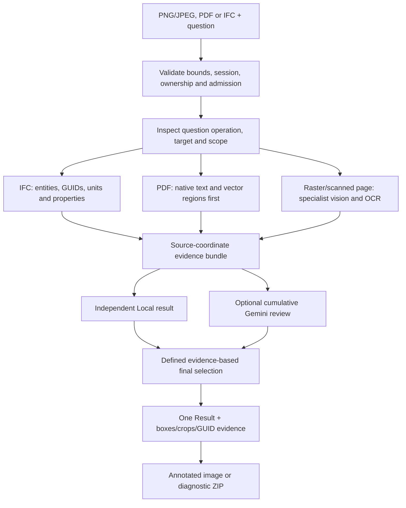
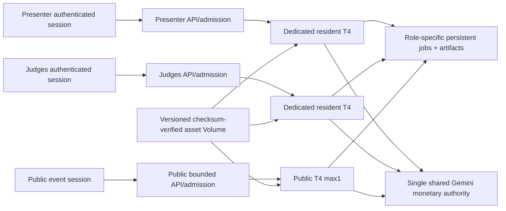

# FloorHAWK architecture and working pipeline

Academic Menaces · STOA — Make Blueprints Talk · Junction 2026.

FloorHAWK turns a drawing question into an inspectable answer using format-specific tools and optional visual review. The browser is a viewer/controller, not an inference client with credentials. Source code remains one canonical Python application; the laptop and Modal adapters reuse its registered operations.

## Inputs, routing and supported facts

The question router registers operation, target, filters and document scope. It does not select answers by filename, question ID or a reference lookup. Ambiguous questions remain unsupported/abstained rather than becoming invented measurements.

|Component|Role|Important limits|
|---|---|---|
|IfcOpenShell|Explicit IFC occurrences, properties, units, quantities and GUIDs|Missing quantities are not zero; a PDF does not imply access to associated IFC|
|PyMuPDF native tools|Printed labels/areas and source-coordinate PDF text/vector evidence|Apartment sums need explicit membership; derived areas need closed native polygons and explicit physical PDF scale|
|PP-OCRv5 CPU ONNX|Observed text and text boxes on raster/rendered pages|OCR omissions, rotation and repeated labels remain possible; OCR labels are not object silhouettes|
|RT-DETR-L|Native classes wall, door, window, railing, linkage_point; production structural counts use supported instances|Detector scores are not calibrated probabilities or completeness guarantees|
|CubiCasa|Room/icon segmentation plus existing calibrated heads|Sauna room semantics are derived from graph/labels/heads, not a native sauna-room detector class|
|Supplied YOLO11m|Nine fixture/structural classes; validated candidate uses sinks, toilet fixtures, showers/baths and door corroboration|CubiCasa-derived training membership unavailable; potential overlap; window profile was not selected|
|Gemini|Interpret cumulative model observations, source overview/crops, OCR and question scope|A schema-valid proposal is not verified truth; new regions are model-proposed; no reference answers|
|Small proposal selector|Ranks available Local, explicit OCR-label and visual-review instance proposals|Drawing-group development calibration; cannot generate an arbitrary count; ranking score is not probability|

Candidate settings live in `config/overnight-candidate.json`; original v3 defaults remain in `v3/config.json`. Full model provenance is in `MODEL_REGISTRY.json`, `v2/registry.json`, `config/artifacts.json` and the external release manifests. Gemma/new segmentation models were not added overnight. No major vision training was performed.

## Preprocessing and postprocessing

The source file is retained and hashed. Preview resizing is for display; evidence crops use original raster pixels or PDF rendering with page/rotation metadata. RT-DETR uses its actual square-stretch contract and maps boxes back to source coordinates; YOLO uses its letterbox contract. CubiCasa uses its recorded normalization, resolution and rotation profile.

Count outputs use unique included instances and class-aware duplicate suppression. Adjacent distinct objects must survive. Counts are never obtained by averaging competing models. A zero prediction does not establish verified absence.

The existing large-drawing route remains bounded and feature-gated. It uses overlapping source-resolution tiles, mapped coordinates and duplicate suppression. Global room/storey heads are not summed across tiles. Incomplete coverage must be disclosed; it is not a whole-sheet total. A CPU tile alternative tested overnight did not improve the pilot and was not promoted.

## Shared evidence and final answer

Local extraction executes once within a request. Observations retain source hash, page/storey, model/checkpoint hash, preprocessing/postprocessing configuration, regions, warnings and timing/cache provenance. Local output is saved before review. Deterministic IFC/native-PDF facts and supported unique specialist instances can supply the final result without Gemini. Semantic review receives cumulative local observations and bounded source imagery, never evaluation labels.

The optional selector chooses an existing supported proposal; it does not average counts. Local and review outputs remain separately stored for analytics. Provider/schema failure preserves Local and is labelled as a local fallback. Count disagreement alone does not reveal which objects were missed. Evidence does not become spatial ground truth merely because it supports a numerical answer.

## Caching and evaluation isolation

Development extraction caches include content hash, checkpoint hash, adapter/configuration version, resolution/orientation/tiles and source transforms. Writes are atomic and reusable across questions. Cached result retrieval is not fresh inference latency.

Live accepted submissions perform their required inference afresh. Models/engines stay loaded; source previews and IFC display geometry may be cached. Only within-request extraction is shared. Completed job reopening displays that saved job without resubmission and is never presented as a new inference.

References are evaluator/UI resources. Exact curated questions may show a separate reference; editing the question or replacing the source clears it. The API checks association independently. Reference files are not mounted as inference inputs and are not added to provider context.

## Modal roles, storage and access

`deploy/modal/event.py` configures one backend for presenter, judges, public and isolated candidate roles. Each has its own admission state/job Volume and GPU queue. No cloud worker uses the laptop bridge. Python3.11 cloud functions are module-defined, not serialized local3.10 closures. One resident T4 per role bounds concurrency; warm presenter/judges workers are billable. CPU parsing remains on CPU. Weight loading happens in worker initialization; load counters and actual tensor devices are recorded.

Session ownership is checked before every private job/file response. Access codes/keys remain outside Git and browser source. Public admission retains rolling five-question and two-distinct-upload limits per code, one active job per visitor and ten waiting jobs; a conservative cumulative compute-reservation guard is separate from provider billing. Quotas and idempotency survive container restarts using atomic Modal Dict locking. Locks fail closed on crash; operator recovery requires verification that the matching app is stopped, and does not reset usage history.

Artifact publication uses explicit Volume commits/reloads. An API process can retain synchronization state for an already-published immutable terminal job, avoiding repeated reloads for its image/crops. This does not reuse that job's answer for another submission. Independent containers never share SQLite WAL as a transactional database.

## Gemini accounting

The preserved canonical lifetime ledger contains the100USD authorization and the existing80USD non-overlapping presenter envelope. All new event workers reserve against the same durable Modal authority, never separately cloned local ledgers. The old prepaid public pool remains part of prior reservations, not extra spending capacity. Every dispatched attempt is accounted for; retries are bounded. Stop switches, timeouts and finite-cost checks fail closed.

Reservations, known token-price estimates, missing thinking-token information and dashboard billing are separate quantities. The last user-reported provider spend is not silently treated as a freshly reconciled bill. No application reservation can guarantee a platform-enforced hard-dollar ceiling.

## IFC display and evidence

IFC count/property queries do not wait for geometry. The fzk_house_arc GLB is source-hash and byte-hash checked, with real mesh-to-GlobalId mapping. Only linked saved GUIDs highlight. Other IFC files never receive the fzk model as a substitute; unavailable geometry leaves an honest placeholder/property view. The browser loads geometry asynchronously with stale-source tickets.

## Reproduction and honest metrics

See `docs/OVERNIGHT_DEVELOPMENT.md` for frozen development denominators, matched rescues/regressions and error measures. The best overnight cached/grouped estimate remains below85%; curated browser success is not held-out accuracy. Final provenance distinguishes unknown custom/pretrained overlap and no-known local exposure. Source, weights, settings and release hashes make rollback/reproduction possible without copying datasets into Git.

Operator workflows: `docs/MODAL_DEPLOYMENT.md`, `docs/RELEASE_WORKFLOW.md`, `docs/RECORDING_GUIDE.md`. External artifacts: `ARTIFACTS.md`. This prototype is not a verified commercial construction measurement system; preserve all third-party model/code/data license restrictions.
